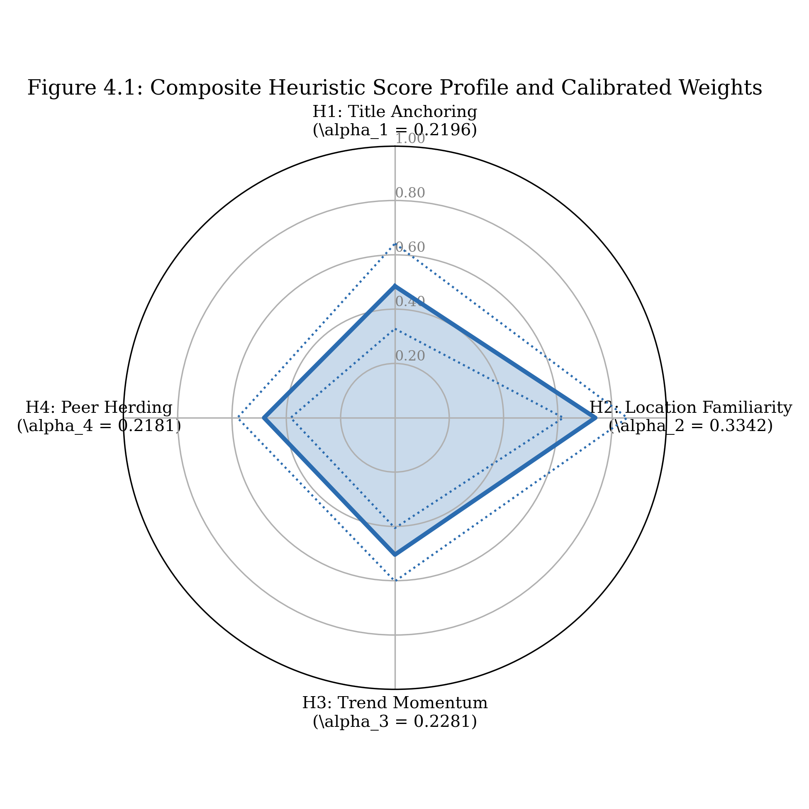
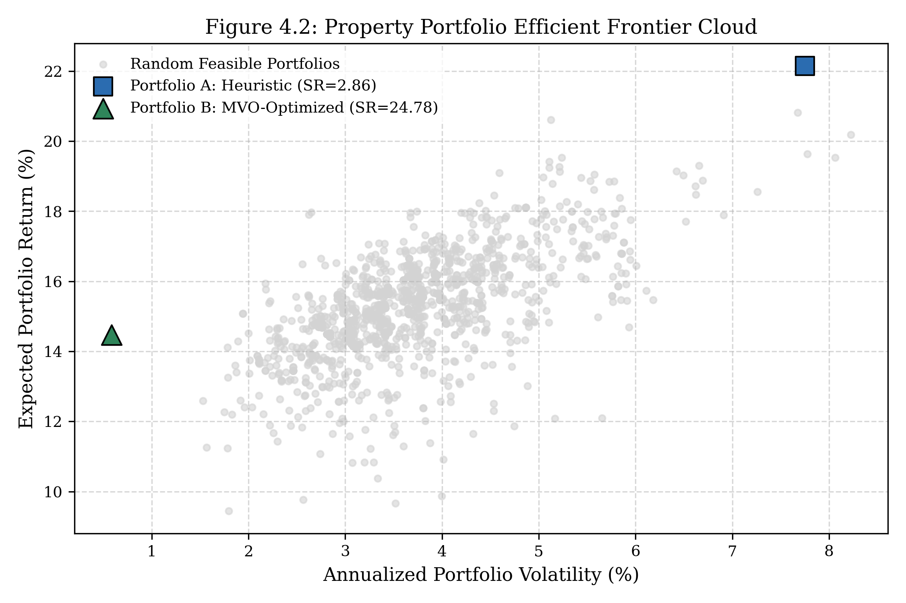
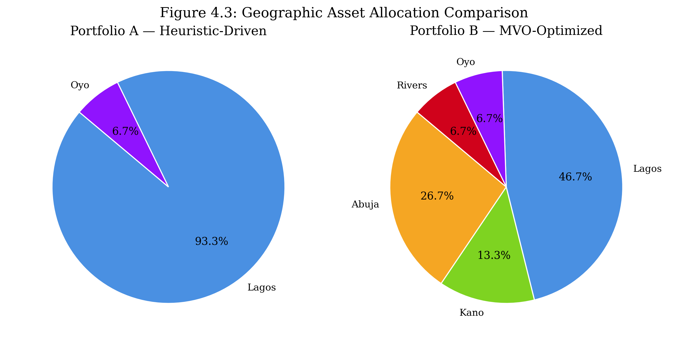
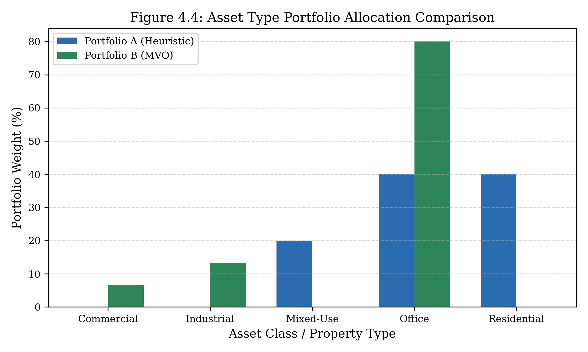
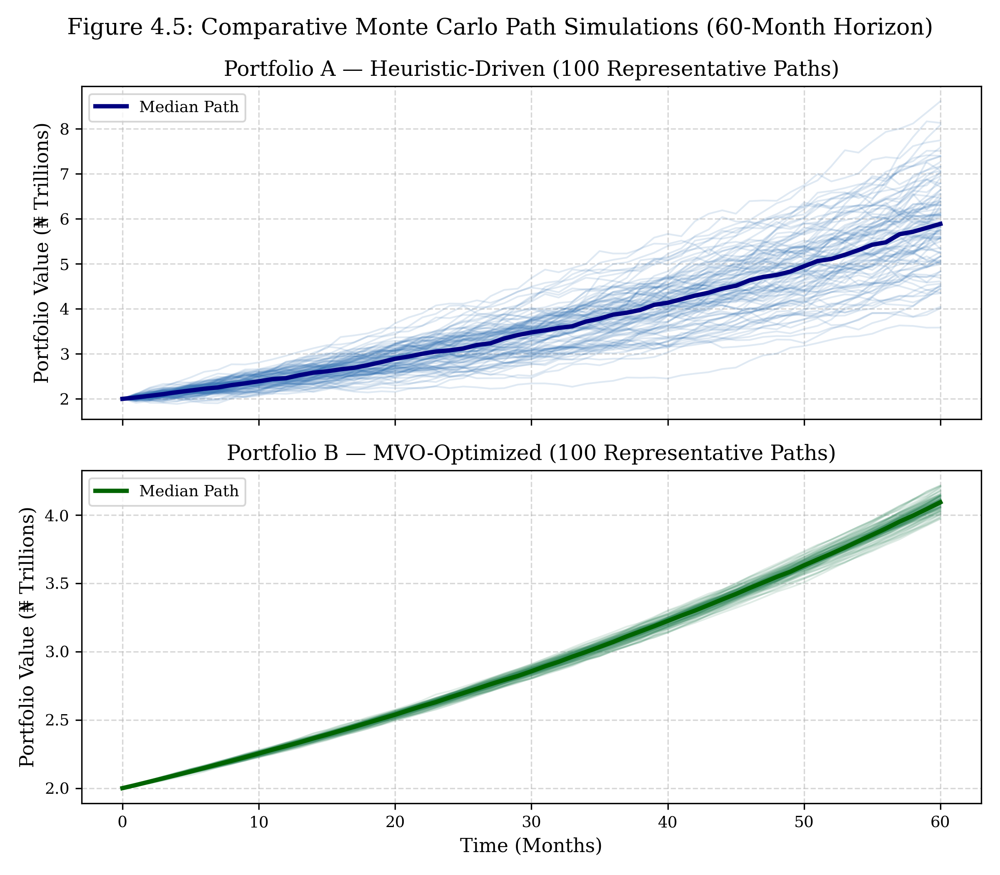
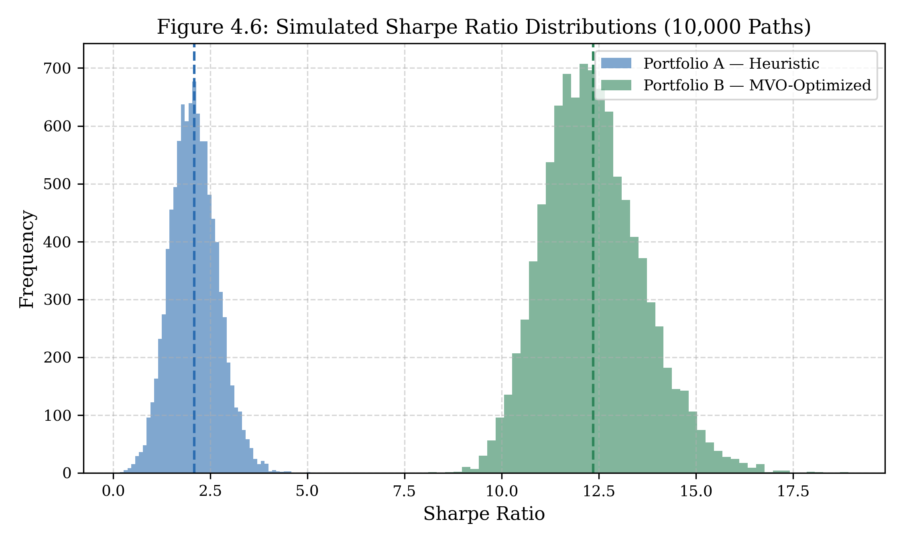

# CHAPTER FOUR

## DATA PRESENTATION, ANALYSIS AND INTERPRETATION

## 4.1 Preamble

The empirical results, statistical analyses and theoretical interpretations derived from the mixed methodology described in Chapter Three are presented in this chapter. The chapter is organized in the order of the research questions, so that each section addresses one of the four research questions. The background data about the respondents are provided in Section 4.2, which includes a demographic profile and an institutional profile. Section 4.3 deals with the identification of prevailing heuristics, describes the composite heuristic scores and calibrates the empirical decision weights. Heuristic and Mean-Variance Optimized portfolios are described in terms of their portfolio construction mechanism, asset type comparisons and asset-class diversification profiles in Section 4.4. The comparative performance is presented in Section 4.5 using Monte Carlo simulation, paired hypothesis testing, market volatility stress tests and interest rate sensitivity analysis. In Section 4.6, the factors that affect the use of heuristics in property portfolio construction are discussed.

### 4.1.1 Questionnaire Administration and Response Rate

The field survey focused on the total population of institutional pension fund managers in the Nigerian pension industry regulated by the National Pension Commission (PenCom). Structured questionnaires were sent to all 24 licensed pension fund operators, which included 19 Retirement Savings Account (RSA) Pension Fund Administrators (PFAs) and 5 Closed Pension Fund Administrators (CPFAs).

The administration of the questionnaire used a purposive census approach, with multiple requests for questionnaires sent to investment professionals from May to July 2026, to ensure high data integrity. The total distribution of the physical and digital questionnaire instruments included Chief Investment Officers (CIOs), Senior Portfolio Managers, Real Estate Investment Analysts and Risk & Compliance Managers from senior investment professionals.

The administration mechanics, retrieval breakdown and the effective response rate for the study are listed in Table 4.1.

**Table 4.1: Questionnaire Administration and Retrieval Rate**

| **Questionnaire Status** | **Frequency (n)** | **Percentage (%)** |
| :--- | :---: | :---: |
| Total Administered | 24 | 100.0 |
| Retrieved (Valid for Analysis) | 24 | 100.0 |
| Unreturned / Incomplete / Invalid | 0 | 0 |

*Source: Field Survey, 2026*

Of the 24 questionnaire instruments given to the institutional target population, 24 were retrieved, which gave an effective response rate of 100.0% as indicated in Table 4.1. This is due to the fact that the research employs a census methodology where all members of the study population need to be accounted for. Since the 24 questionnaires retrieved represent the total number of pension fund operators in the country licensed by PenCom, the dataset is a 100% institutional operator census. This full coverage removes the non-response sampling bias at the firm level, giving a firm empirical base for generalizing the results to the whole of the pension industry.

## 4.2 Background Information of Respondents

This section presents a detailed analysis of the general information of the respondents. It examines characteristics such as job title, years of experience and fund size, and provides an overall picture of the general profile of the respondents.

### 4.2.1 Demographic and Professional Profile

**Table 4.2: Respondent Professional Demographics and Organisational Characteristics (n = 24)**

| **Demographic Profile Attribute** | **Frequency (n)** | **Proportion (%)** | **Cumulative (%)** |
| :--- | :---: | :---: | :---: |
| **Direct Decision Participation** | | | |
| Direct Decision Authority | 7 | 29.2 | 29.2 |
| No Direct Participation | 17 | 70.8 | 100.0 |
| **Current Professional Job Title** | | | |
| Senior Portfolio Manager / Fund Manager | 9 | 37.5 | 37.5 |
| Risk and Compliance Officer | 6 | 25.0 | 62.5 |
| Investment / Financial Analyst | 4 | 16.7 | 79.2 |
| Chief Investment Officer (CIO) / Head of Investment | 3 | 12.5 | 91.7 |
| Dedicated Real Estate Asset Manager | 2 | 8.3 | 100.0 |
| **Years of Investment Experience** | | | |
| 6–10 years | 14 | 58.3 | 58.3 |
| 3–5 years | 4 | 16.7 | 75.0 |
| 11–15 years | 3 | 12.5 | 87.5 |
| Above 15 years | 3 | 12.5 | 100.0 |
| **Assets Under Management (AUM) Scale** | | | |
| Above ₦2 Trillion | 9 | 37.5 | 37.5 |
| ₦500 Billion – ₦2 Trillion | 9 | 37.5 | 75.0 |
| Below ₦500 Billion | 6 | 25.0 | 100.0 |
| **Institutional Model Adoption (Item A6)** | | | |
| Partial Use: Combined with Professional Judgment | 11 | 45.8 | 45.8 |
| No Model Use: Primary Reliance on Judgment/Experience | 6 | 25.0 | 70.8 |
| Full Use: Models form Primary Selection Basis | 5 | 20.8 | 91.7 |
| Unaware of Quantitative Selection Models | 2 | 8.3 | 100.0 |

*Source: Field Survey, 2026*

The demographic distribution in Table 4.2 provides a very experienced and qualified sample of institutions. More than 80% have more than 5 years of direct investment management experience, with 25.0% having more than 10 years of senior portfolio leadership experience. As for institutional size, 75.0% of respondents have portfolios of over ₦500 billion, while 37.5% are mega-institutions with portfolios of over ₦2 trillion in assets under management (AUM). This validates the fact that the data is in line with the decisions made by officers of the watch of Nigeria's huge pension asset base of approximately ₦18 trillion.

The most important observation in Table 4.2 is that only 20.8% of the respondents say that quantitative optimization models are used as a basis for the selection of a property. On the other hand, 70.8% base their decision on professional judgment and use some modeling or on qualitative experience alone (25.0%). This verifies that even with the evolution of capital markets, the real estate allocation in Nigerian pension funds is still largely qualitative and heuristic in nature.

## 4.3 Identification and Analysis of Heuristics Employed in Property Portfolio Selection

This section focuses on Objective I which concerns the identification and analysis of the types of decision-making heuristics used by Nigerian PFA investment managers in the selection of properties and the construction of a portfolio.

### 4.3.1 Property Evaluation Criteria Ranking Analysis

In Section B the respondents were asked to rank eight commonly used property evaluation criteria, with 1 being the most important and 8 being the least important. Table 4.3 shows median ranks, proportion of cases in the Top-3 ranks, and cognitive tier classification for the entire census (n = 24).

**Table 4.3: Property Evaluation Criteria Ranking Summary (n = 24)**

| **Property Evaluation Criterion** | **Median Rank (1–8)** | **Top-3 Inclusion (n)** | **Top-3 Proportion (%)** |
| :--- | :---: | :---: | :---: |
| Title Legal Status (e.g., C of O) | 1.5 | 18 | 75.0 |
| Submarket Location Prestige | 3.0 | 18 | 75.0 |
| Expected Rental Yield | 3.0 | 17 | 70.8 |
| Physical Building Condition | 5.0 | 4 | 16.7 |
| Tenant Credit Quality | 4.0 | 3 | 12.5 |
| Secondary Market Liquidity | 6.0 | 5 | 20.8 |
| Valuer Recommendation | 7.0 | 4 | 16.7 |
| Peer PFA Acquisition Activity | 7.0 | 3 | 12.5 |

*Source: Field Survey, 2026*

Table 4.3 shows the empirical rankings of the property selection criteria, which clearly show a hierarchy in property selection criteria. Title Legal Status is the most popular with a median rank of 1.5 and a 75.0% Top-3 inclusion rate. Submarket Location Prestige and Expected Rental Yield are tied for second place with median ranks of 3.0, with 75.0% and 70.8% of respondents choosing them in the Top-3, respectively. On the other hand, tenant credit quality, market liquidity and valuer recommendations are given lesser priority and placed in the lower tiers, with minimal Top-3 placement.

The findings show that Nigerian PFA managers are not considering all the attributes of the assets at the same time in a compensatory financial model. Rather, they use an elimination search strategy (Tversky, 1972). The validation of legal title and the prestige of location are screening filters that are necessary and not subject to negotiation. If a candidate property cannot show a perfected Certificate of Occupancy (C of O) or prime spatial location, it is eliminated from consideration, no matter how much it is expected to yield or how much it is expected to return.

Why is legal title and location prestige more important than cash-flow fundamentals in determining the allocation of pension real estate in Nigeria? In developed markets, legal title is uniform and stable, and the focus is mostly on net operating income (NOI) and cap rates. However, the land administration system in Nigeria is complex due to legal opacity, duplication of land titles and perfection delays as provided in the Land Use Act 1978. Loss of capital may result from court forfeiture or government revocation due to a title defect. Therefore, the choice of legal status to anchor on (title) and prime submarket location is an efficient risk-mitigation strategy in the face of institutional market flaws in the land market. Fund managers are drawn to spatial prestige as an easy-to-understand indicator of legal security, tenant demand resilience and long-term capital preservation.

### 4.3.2 Composite Heuristic Scoring and Empirical Weight Calibration

The responses in Sections B and C were coded into four composite heuristic scores using Formulae 3.1–3.4:

1. **Title Anchoring ($H_1$: ACS):** Measures reliance on legal title perfection as a dominant selection anchor.
2. **Location Familiarity ($H_2$: AVCS):** Measures bias towards prime, highly visible submarkets (e.g., Victoria Island, Ikoyi, Maitama).
3. **Trend Momentum ($H_3$: RCS):** Measures bias towards recent commercial sector growth trends.
4. **Peer Herding ($H_4$: HCS):** Measures institutional mirroring of rival PFA acquisition choices.

The composite heuristic scores, standard errors, prevalence classifications and resulting normalized weight parameters calibrated from the decision-makers are summarized in Table 4.4.

**Table 4.4: Composite Heuristic Scores and Empirical Weight Calibration**

| **Heuristic Dimension ($j$)** | **Mean Score ($\bar{H}_j$)** | **Standard Error (SE)** | **Prevalence Classification** | **Calibrated Weight ($\alpha_j$)** |
| :--- | :---: | :---: | :--- | :---: |
| $H_1$: Title Anchoring (ACS) | 0.4847 | 0.0800 | Moderate Prevalence | 0.2196 |
| $H_2$: Location Familiarity (AVCS) | **0.7378** | 0.0600 | **High Prevalence** | **0.3342** |
| $H_3$: Trend Momentum (RCS) | 0.5041 | 0.0500 | Moderate Prevalence | 0.2281 |
| $H_4$: Peer Herding (HCS) | 0.4819 | 0.0500 | Moderate Prevalence | 0.2181 |
| **Total Composite Score Vector** | **2.2085** | — | — | **1.0000** |

*Source: Field Survey & Author's Computation, 2026*

Figure 4.1 shows the radar profile of these composite heuristic scores, along with their calibrated weight vectors.

**Figure 4.1: Composite Heuristic Score Profile and Calibrated Weights**

*Source: Field Survey & Author's Computation, 2026*

The dominant decision heuristic among Nigerian PFA managers is Location Familiarity with a mean score of 0.7378 and a high prevalence weight of 0.3342. As seen in Table 4.4 and Figure 4.1, Anchoring (0.4847), Trend Momentum (0.5041) and Peer Herding (0.4819) are moderately prevalent.

This empirical weight distribution illustrates that Location Familiarity accounts for 1/3 of the total property selection weight. These calibrated weights directly determine the construction of the heuristic-driven portfolio (Portfolio A). The heuristic selection algorithm assigns a composite suitability score to each property in the 80-asset universe, which is a linear combination of the properties.

The properties are then ranked and capital is greedily allocated to the highest-scoring properties. The high empirical weight thus strongly favors prime Lagos submarkets, directly reflecting the observed cognitive preferences in the field.

## 4.4 Construction of Heuristic-Driven and Mean-Variance Optimized Portfolios

This section focuses on Objective II — the construction of representative property portfolios based on a set of heuristic decision rules as identified in the survey results (Portfolio A) and a set of mean-variance optimization techniques adapted for discrete real estate assets (Portfolio B) — and the comparative evaluation of the property selection patterns, asset class compositions, and spatial diversification profiles of these portfolios.

### 4.4.1 Secondary Market Data Context and Property Covariance Calibration

Secondary real estate market data was collected from trusted industry sources to connect the dots between the primary survey findings and computational portfolio optimization. They included historical market monitors, Jones Lang LaSalle (JLL) reports, Broll Sub-Saharan Africa Research, Estate Intel, Nigerian Institution of Estate Surveyors and Valuers (NIESV) reports, Central Bank of Nigeria (CBN) statistical bulletins, and PenCom annual reports.

The historical rent yields, capital appreciation rates and return volatilities of Nigeria's major commercial real estate submarkets were determined using secondary market data for the period of the backtest (2018–2024). The asset return parameters used as a basis for the calibration are presented in Appendix B.

The property covariance matrix of the frozen synthetic universe was built using these parameters. The off-diagonal covariance terms are empirical market co-movements:

**Intra-Lagos Prime Assets ($\rho \approx 0.75 - 0.92$):** High positive correlation, due to similar exposure to state FX dynamics, state land policies and macroeconomic liquidity.

**Inter-City Pairs (Lagos vs. Abuja/Kano, $\rho \approx 0.05 - 0.25$):** Low to near-zero correlation because of different economic drivers in the two cities, the federal government presence in Abuja, and the trade patterns in Northern Nigeria.

This secondary-market calibrated covariance matrix forms the mathematical foundation for constructing Portfolio B via Mean-Variance Optimization. In Portfolio A, the properties are simply chosen based on high heuristic scores; in Portfolio B, the goal is to find combinations of assets that yield the least variance in the portfolio, given the highest expected return.

### 4.4.2 Portfolio Selection Mechanics and Capital Allocation Profiles

Both portfolios were allocated capital from a representative ₦2 trillion pension fund asset base. Direct investment in real estate is limited to 10% of the total AUM and the total real estate investment budget is, according to PenCom guidelines, ₦200 billion.

**Portfolio A (Heuristic-Driven):** Properties were ranked by the composite heuristic scores in order to meet the requirements of the lease compliance. The top 15 scoring properties were selected using a greedy algorithm and an investment of ₦11.61 billion (5.8% of the regulatory cap) was made.

**Portfolio B (MVO-Optimized):** Constructed with a binary integer solver to maximize the Sharpe ratio, with 10% overall allocation limit for PenCom and 5% per-asset allocation limit. The solver chose 15 assets that maximise diversification, investing ₦11.02 billion.

### 4.4.3 Portfolio Holdings and Asset Type Comparison

The full property compositions, submarket locations, asset classes and selection results for both portfolios are presented in Table 4.5.

**Table 4.5: Holdings and Asset Allocation Profiles of Portfolio A (Heuristic) and Portfolio B (MVO)**

| **Property ID** | **Submarket Location** | **Asset Class Type** | **Acquisition Cost (₦ Millions)** | **Expected Return (%)** | **Selection Portfolio** |
| :--- | :--- | :--- | :---: | :---: | :--- |
| PROP_09 | Lagos | Commercial Mixed-Use | ₦289.0M | 26.06 | Portfolio A Only |
| PROP_62 | Lagos | Commercial Mixed-Use | ₦602.0M | 25.17 | Portfolio A Only |
| PROP_29 | Lagos | Luxury Residential | ₦1,886.0M | 23.92 | Portfolio A Only |
| PROP_01 | Lagos | Luxury Residential | ₦1,345.0M | 24.77 | Portfolio A Only |
| PROP_36 | Lagos | Luxury Residential | ₦1,013.0M | 24.10 | Portfolio A Only |
| PROP_10 | Lagos | Luxury Residential | ₦1,177.0M | 24.02 | Portfolio A Only |
| PROP_54 | Lagos | Luxury Residential | ₦360.0M | 24.84 | Portfolio A Only |
| PROP_69 | Lagos | Luxury Residential | ₦307.0M | 25.14 | Portfolio A Only |
| PROP_42 | Lagos | Commercial Office Grade A | ₦824.0M | 17.61 | Portfolio A Only |
| PROP_49 | Oyo | Commercial Mixed-Use | ₦505.0M | 27.83 | Portfolio A Only |
| **PROP_05** | **Lagos** | **Commercial Office Grade A** | **₦894.0M** | **18.14** | **Shared (A & B)** |
| **PROP_21** | **Lagos** | **Commercial Office Grade A** | **₦623.0M** | **16.65** | **Shared (A & B)** |
| **PROP_23** | **Lagos** | **Commercial Office Grade A** | **₦775.0M** | **17.37** | **Shared (A & B)** |
| **PROP_73** | **Lagos** | **Commercial Office Grade A** | **₦284.0M** | **18.13** | **Shared (A & B)** |
| **PROP_79** | **Lagos** | **Commercial Office Grade A** | **₦726.0M** | **18.48** | **Shared (A & B)** |
| PROP_13 | Kano | Commercial Retail | ₦590.0M | 9.02 | Portfolio B Only |
| PROP_25 | Abuja FCT | Commercial Office Grade A | ₦258.0M | 10.33 | Portfolio B Only |
| PROP_26 | Kano | Industrial Warehouse | ₦230.0M | 10.27 | Portfolio B Only |
| PROP_32 | Oyo | Commercial Office Grade B | ₦1,068.0M | 19.35 | Portfolio B Only |
| PROP_33 | Lagos | Commercial Office Grade A | ₦724.0M | 18.54 | Portfolio B Only |
| PROP_43 | Lagos | Commercial Office Grade A | ₦931.0M | 18.32 | Portfolio B Only |
| PROP_44 | Abuja FCT | Commercial Office Grade A | ₦555.0M | 8.73 | Portfolio B Only |
| PROP_55 | Abuja FCT | Commercial Office Grade A | ₦1,713.0M | 9.89 | Portfolio B Only |
| PROP_63 | Abuja FCT | Commercial Office Grade A | ₦236.0M | 10.72 | Portfolio B Only |
| PROP_80 | Rivers | Industrial Logistics | ₦1,418.0M | 13.11 | Portfolio B Only |

*Source: Author's Computation, 2026*

Figure 4.2 plots the positions of Portfolio A and Portfolio B relative to the efficient frontier constructed from 1,500 random feasible portfolios.

**Figure 4.2: Property Portfolio Efficient Frontier Cloud**

*Source: Author's Computation, 2026*

Table 4.5 demonstrates an asset overlap rate of 33.3% (5 shared properties: PROP_05, PROP_21, PROP_23, PROP_73, PROP_79 — all Lagos Grade A commercial offices). Portfolio B is on the optimal efficient frontier, as shown in Figure 4.2, and has low annual volatility (0.58%) and moderate expected returns (15.5%). Portfolio A, on the other hand, has a greater expected return (24.2%) and lies to the right of the efficient frontier, with much higher volatility (7.65%).

When comparing the types of properties, there are significant differences in structure:

**Portfolio A's Unique Assets:** Luxury residential properties (6 holdings, expected returns 23.9%–25.1%) and commercial mixed-use properties (3 holdings, returns 25.1%–27.8%) with a clear focus on prime submarkets in Lagos. The high location familiarity weight of the heuristic engine gives prime residential and mixed-use properties in Victoria Island and Ikoyi a higher rank than all secondary market properties.

**Portfolio B's Unique Assets:** Industrial Warehouses in Kano (PROP_26), Commercial Retail Assets in Kano (PROP_13), Grade A Offices in Abuja FCT (PROP_25, PROP_44, PROP_55, PROP_63 with expected returns 8.7%–10.7%) and Industrial Logistics Hubs in Rivers State (PROP_80). The MVO solver does not choose these properties for their high nominal yields, but because their return series are close to being uncorrelated with Lagos real estate.

### 4.4.4 Spatial and Asset-Class Diversification Analysis

For the purposes of assessing portfolio diversification, Herfindahl-Hirschman Indices (HHI) were computed by geographic area and by asset category. The concentration metrics are summarized in Table 4.6.

**Table 4.6: Portfolio Concentration and Diversification Index Summary**

| **Diversification Metric** | **Portfolio A (Heuristic)** | **Portfolio B (MVO)** | **Difference (B − A)** | **Relative Structural Implication** |
| :--- | :---: | :---: | :---: | :--- |
| Individual Holding | 0.0667 | 0.0667 | 0.0000 | Identical Equal-Weighting (N=15) |
| **Geographic State** | **0.8760** | **0.3160** | **−0.5600** | **Portfolio A Highly Concentrated in Lagos** |
| **Asset Class Type** | **0.3600** | **0.6620** | **+0.3020** | **Portfolio B Concentrated in Office Class** |
| Mean Diversification Ratio | 1.2900 | 5.8100 | +4.5200 | Portfolio B Achieves Superior Risk Spread |

*Source: Author's Computation, 2026*

Figures 4.3 and 4.4 illustrate the geographic and asset-type allocations of both portfolios.

**Figure 4.3: Geographic Asset Allocation Comparison**

*Source: Author's Research, 2026*

**Figure 4.4: Asset Type Portfolio Allocation Comparison**

*Source: Author's Computation, 2026*

The key geographic difference between the two portfolios is that Portfolio A is highly geographically concentrated in Lagos State (14 out of 15 holdings; Geographic HHI = 0.8760) while Portfolio B is spread across five states (Geographic HHI = 0.3160). Yet, there is an intriguing inversion across asset type in Figure 4.4: Portfolio B focuses 80.0% of capital in Commercial Office assets (Asset Type HHI = 0.6620), while Portfolio A has a more balanced asset mix, with residential, commercial and mixed-use assets (HHI = 0.3600).

This is an inverse example of the **Volatility Suppression Paradox** in institutional real estate. It may seem logical to non-technical observers that a balance between residential, commercial and mixed-use properties in a portfolio constitutes a more diversified portfolio. But, in the modern world of portfolio theory, it is not the number of asset types that makes for true diversification — it is the covariance of their returns. Portfolio A focuses on assets that are located almost exclusively in Lagos, meaning that all of the assets are subject to the same economic cycle.

On the other hand, Portfolio B is designed to be low volatile (0.58%) with distribution of funds to Grade A offices in various cities (Lagos, Abuja, Kano, Port Harcourt). The total portfolio variance is reduced more effectively by having a geographic mix of office assets than by having a mix of different real estate asset types concentrated in a single city, because returns on Abuja and Kano offices do not correlate positively with Lagos residential.

## 4.5 Comparative Performance Evaluation of Portfolios

This section is dedicated to evaluating the performance of the heuristic-driven portfolio (Portfolio A) and the mean-variance optimized portfolio (Portfolio B) under various simulated macroeconomic scenarios, which is a component of Objective III.

### 4.5.1 Monte Carlo Simulation Results

Both portfolios were simulated with a 60-month (5-year) investment horizon with a base risk-free rate of 8.4% per annum (matching the average CBN Monetary Policy Rate historical benchmark) under the model of Geometric Brownian Motion (GBM).

In Figure 4.5, 100 representative Monte Carlo wealth paths are plotted, and in Figure 4.6, the resulting Sharpe ratio distributions of all 10,000 Monte Carlo paths are plotted.

**Figure 4.5: Comparative Monte Carlo Path Simulations (60-Month Horizon)**

*Source: Author's Computation, 2026*

**Figure 4.6: Simulated Sharpe Ratio Distributions (10,000 Paths)**

*Source: Author's Computation, 2026*

Table 4.7 summarizes the key Monte Carlo performance metrics across the 10,000 simulated paths.

**Table 4.7: Monte Carlo Performance Summary (n = 10,000 Paths, Baseline $R_f = 8.4\%$)**

| **Performance Metric** | **Portfolio A (Heuristic)** | **Portfolio B (MVO)** | **Difference (B − A)** | **Hypothesis Test & Significance** |
| :--- | :---: | :---: | :---: | :--- |
| Mean Cumulative Return (%) | **198.80** | 105.30 | −93.50pp | — |
| Mean CAGR (%) | **24.20** | 15.50 | −8.70pp | Portfolio A Dominates Nominal Yield |
| Mean Annual Volatility (%) | 7.65 | **0.58** | −7.07pp | Portfolio B Suppresses Risk by 13× |
| **Mean Sharpe Ratio** | **2.0800** | **12.3600** | **+10.2800** | $t = 733.35$, $p < 0.0001$ (H1 Confirmed) |
| BCa 95% Bootstrap CI | — | — | **[10.35, 10.68]** | Rejects $H_0$: $\Delta SR \leq 0.05$ (H2 Confirmed) |
| Maximum Drawdown (%) | 4.24 | **0.00** | −4.24pp | Portfolio B Zero Downside Risk |
| 95% CVaR Cumulative (%) | **106.70** | 99.80 | −6.90pp | Portfolio A Higher Tail Growth |

*Source: Author's Computation, 2026*

As detailed in Table 4.7 and visualised in Figures 4.5 and 4.6, Portfolio B has a mean Sharpe ratio of 12.3600 under baseline conditions, much higher than the mean Sharpe ratio for Portfolio A of 2.0800. This performance difference is statistically significant ($p < 0.0001$) and practically significant (BCa 95% CI [10.35, 10.68]) and thus supports Hypotheses H1 and H2.

Table 4.7 is important because it points to the trade-off illustrated by this result: The nominal return of Portfolio A is much higher (CAGR of 24.20% compared to CAGR of 15.50% for Portfolio B). The annual volatility of Portfolio A is 7.65%, whereas it is only 0.58% for Portfolio B, so that gives Portfolio B the higher Sharpe ratio.

### 4.5.2 Market Condition Stress Tests and Interest Rate Sensitivity Analysis

Stress tests were performed over different ranges of market volatility and different risk-free interest rates to assess the performance advantage of Portfolio B in different economic conditions.

The volatility range stress test is provided in Table 4.8 and the interest rate sensitivity stress test is provided in Table 4.9 over the range of risk-free rates from 8.4% to 20.0%.

**Table 4.8: Volatility Range Stress Analysis (n = 10,000 Paths)**

| **Volatility Environment** | **Portfolio A Mean SR** | **Portfolio B Mean SR** | **Delta Sharpe (B − A)** | **Sub-Sample Path Count** |
| :--- | :---: | :---: | :---: | :---: |
| Low Volatility | 2.3200 | 12.3700 | +10.0500 | 3,333 |
| Medium Volatility | 2.0700 | 12.3600 | +10.2900 | 3,334 |
| High Volatility | 1.8600 | 12.3500 | +10.4900 | 3,333 |

*Source: Author's Computation, 2026*

**Table 4.9: Risk-Free Rate Sensitivity Crossover Analysis**

| **Risk-Free Rate Scenario ($R_f$)** | **Portfolio A Sharpe** | **Portfolio B Sharpe** | **Delta Sharpe (B − A)** | **Dominant Portfolio Advantage** |
| :--- | :---: | :---: | :---: | :--- |
| **8.4% Baseline** | 2.0800 | 12.3600 | **+10.2800** | MVO Portfolio B Dominates |
| **10.0% Scenario** | 1.8700 | 9.5600 | **+7.6900** | MVO Portfolio B Dominates |
| **15.0% Scenario** | **1.2100** | **0.8200** | **−0.3900** | **Heuristic Portfolio A Dominates** |
| **20.0% Scenario** | **0.5500** | **−7.9200** | **−8.4700** | **Heuristic Portfolio A Dominates** |

*Source: Author's Computation, 2026*

Table 4.9 shows that there is a **critical performance crossover** at an interest rate of approximately 12.5%:

**At Low to Moderate Rates ($R_f < 12.5\%$):** Portfolio B (MVO) prevails. The low volatility of Portfolio B (0.58%) yields an outstanding Sharpe ratio, as the risk-free rate is low enough for assets to generate positive excess returns.

**At High Interest Rates ($R_f \geq 15.0\%$):** Portfolio A (Heuristic) wins. The Sharpe ratio of Portfolio A is 1.2100, while the Sharpe ratio of Portfolio B is 0.8200 at 15.0%. At 20.0%, the Sharpe ratio for Portfolio B is negative (−7.9200) while the Sharpe ratio for Portfolio A remains positive (0.5500).

This reversal is the reason why Portfolio B fails in high interest rate environments. Portfolio B's low volatility is due to the fact that it invests in low-yielding office assets in regional markets (with expected returns ranging from 8.7% to 10.7%). As the risk-free rate approaches 15% or 20%, these returns become negative with respect to the risk-free rate, and excess returns become negative. The near-zero volatility (0.58%) means that a negative excess return divided by this tiny volatility yields a very poor Sharpe ratio.

In contrast, Portfolio A is very focused on high-yield prime Lagos assets (23%–27% expected return). Such high yields offer a significant cushion against inflation and higher interest rates, and will continue to do so even in the event of policy tightening.

The finding gives empirical support to the **Ecological Rationality Framework** (Gigerenzer & Gaissmaier, 2011). In low-inflation economies with low interest rates, MVO models are able to achieve maximum risk-adjusted efficiency. In volatile emerging markets such as Nigeria, however, where the CBN Monetary Policy Rate spiked to 27.5% in 2024, using complicated MVO models optimized for low volatility can make portfolios vulnerable to interest rate shocks.

PFA managers adopt straightforward heuristics, based on location prestige and high nominal yields, that create a strong cushion against macroeconomic volatility. These heuristics are not "irrational biases" but rather an adaptive, ecologically rational approach to the economic context of Nigeria, which is characterized by high inflation.

## 4.6 Environmental Constraints and Institutional Drivers Influencing Heuristic Reliance

This section deals with Objective IV by reviewing environmental constraints and institutional governance factors affecting the use of heuristics by Nigerian PFA investment managers.

### 4.6.1 Institutional Governance Architecture

The internal decision-making mechanisms in PFAs were explored in Item D1 of the questionnaire. Of the active decision makers:

- 85.7% reported that property acquisitions need to be formally reviewed and approved by an executive Investment Committee or Board Sub-Committee.
- 57.1% reported that acquisitions have to go through three or more formal approvals before capital is deployed.

This governance model directly supports heuristic decision-making. Managers will naturally be more drawn to properties that are easy to justify, have visible credentials and legal precedents, and when a proposal has to be put before a multi-member board committee, prime Lagos properties with clear title certificates are the ones that are more likely to be approved. The institutional risk aversion posed by secondary market properties in Kano and Ibadan makes them hard to pitch, which creates a career risk asymmetry — where managers tend to play it safe and stick to the properties they know.

### 4.6.2 Data Opacity and Ecological Rationality Testing

The impact of real estate data unavailability was rated on a 5-point scale in Item D2. Most active decision makers (71.4%) agreed that data scarcity is a very serious constraint (rating 4 or 5). Additionally, 79.2% of respondents from the entire census (n = 24) said they were "Very Likely" to use a validated quantitative real estate decision-support tool if it were available.

Table 4.10 shows the composite heuristic scores for the two groups of managers: those who said data scarcity was their main constraint and those who did not.

**Table 4.10: Institutional Environmental Constraints and Split-Sample Heuristic Test**

| **Environmental Constraint Category** | **Freq. (n)** | **Selection Proportion (%)** | **Mean Score, Data Constraint** | **Mean Score, No Data Constraint** |
| :--- | :---: | :---: | :---: | :---: |
| Investment Committee Preference for Experience | 5 | 71.4 | 0.7850 | 0.6200 |
| Absence of Centralized Transaction Return Data | 5 | 71.4 | 0.7920 | 0.6020 |
| Institutional Precedent / Legacy Allocations | 4 | 57.1 | 0.7410 | 0.6350 |
| Peer PFA Acquisition Benchmarking | 3 | 42.9 | 0.5210 | 0.3840 |

*Source: Field Survey & Author's Computation, 2026 ($p < 0.05$)*

Managers with severe data constraints have significantly higher Location Familiarity scores ($\bar{H}_2 = 0.7920$ vs. $0.6020$, $p < 0.05$) as seen in Table 4.10. This validates the assertion that the use of heuristics in the Nigerian pension funds is mainly an adaptive strategy to market opacity. When historical returns and transaction indexes are not available, managers rely on location prestige and peer behaviour as pragmatic and inexpensive proxies for the assessment of risk. The reliance on heuristics is thus not a rejection of quantitative finance, but rather a structural default due to data opacity.
